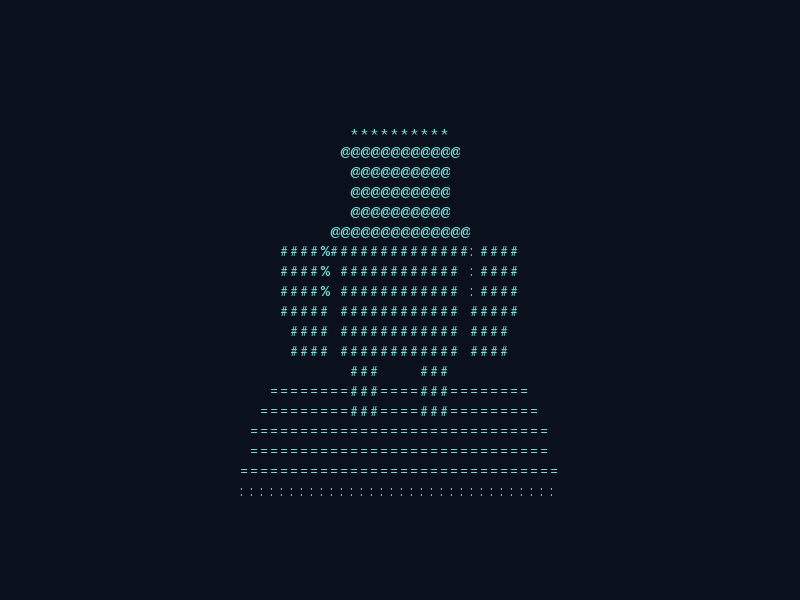
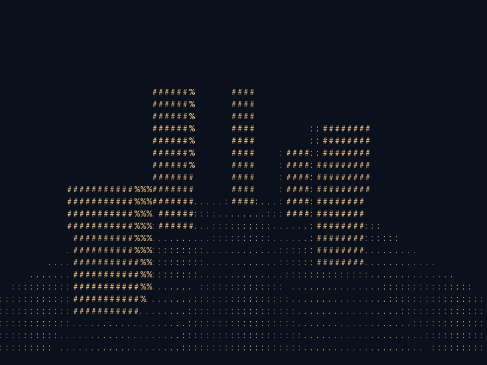

# 3D objects and camera movement

GlyphForge's triangle backend represents objects with XYZ vertices and triangular faces. A camera transforms the world into its own view, projects it onto a character grid, and uses depth to choose which surface is visible at each cell.

## Try the demonstrations

```sh
python -m examples.orbit_camera
python -m examples.dolly_camera
python -m examples.orbit_camera --time 3 --output output/robot-side.svg
python -m examples.dolly_camera --time 1 --output output/pillars.html
```

Both examples keep their geometry fixed in world coordinates. The orbit example circles a robot sculpture made of solid boxes. The dolly example changes camera position around pillars on a tiled floor, showing perspective, parallax, and occlusion. The shared runner provides live animation, resizing, and Q/Escape/Ctrl-C to quit.



## Position, target, and up

The mesh backend uses a left-handed coordinate system: +Y is up and a camera's local +Z axis points forward. `look_at` builds a world-to-view matrix from three values:

- `eye`: camera position in world space.
- `target`: world-space point to look at.
- `up`: preferred vertical direction; defaults to `(0, 1, 0)`.

```python
from glyphforge import MeshEngine
from glyphforge.mesh import look_at

with MeshEngine() as engine:
    camera = engine.create_camera((100, 36), ratio=100 * 0.5 / 36)
    engine.add_mesh(
        "triangle",
        [(-1, -1, 0), (0, 1, 0), (1, -1, 0)],
        [(0, 1, 2), (2, 1, 0)],  # Both sides, for this minimal example.
        ["#", "+"],
    )
    camera.set_transformation(look_at((4, 2, -6), (0, 0, 0)))
    frame = engine.render_cells(camera)
```

The eye and target must differ. The up vector must be nonzero and not parallel to the viewing direction. Invalid or non-finite vectors raise `ValueError`.

## Orbit a fixed object

Update only the camera each frame:

```python
import math
from glyphforge.mesh import look_at

angle = seconds * 0.65
position = (5.8 * math.sin(angle), 2.1, -5.8 * math.cos(angle))
camera.set_transformation(look_at(position, (0, 0, 0)))
frame = engine.render_cells(camera)
```

Model transforms remain unchanged. As the camera circles the object, its visible faces and silhouette change. The full example adds a small variation in camera height so top surfaces are also visible.

## Dolly and parallax

```python
position = (
    2.3 * math.sin(seconds * 0.6),
    1.3,
    -4.8 + 1.4 * math.sin(seconds * 0.4),
)
camera.set_transformation(look_at(position, (0, 0.15, 3.2)))
```

This moves the eye sideways and forward/back while keeping a fixed target. Nearby pillars travel farther across the screen than distant ones. The depth buffer handles surfaces passing in front of one another.



## Camera transforms versus model transforms

`instance.set_transformation(...)` maps local mesh coordinates into world space. `camera.set_transformation(...)` maps world space into view space. Both can animate independently. Use `look_at` for an intuitive camera pose instead of passing a camera's world translation directly as its view matrix.

The mesh camera's `fov` is in radians. Its `ratio` is the viewport's physical width/height; for cells with width/height 0.5, use `columns * 0.5 / rows`. Near and far clipping bounds must satisfy `0 < near < far`.

The separate grid backend uses `View.x`, `View.y`, and `View.angle` on an XY ground plane. These are different coordinate conventions; `look_at` is for `MeshEngine` cameras.

## More scenes using the same camera pattern

The [3D collection](gallery.md#more-3d-objects-and-structures) adds a spacecraft, castle, suspension bridge, orrery, staircase, tetrahedral sculpture, crystals and a kinetic tower. Each uses `look_at` for a camera orbit. The orrery also moves its planets, and the kinetic tower rotates its slabs independently.
