# Creative example gallery

Twenty runnable examples explore three routes into GlyphForge: authored grid scenes, triangle meshes, and custom cell renderers. The procedural examples implement their own visual effects and use the engine for cell validation, terminal presentation, and export; these are not additional built-in 3D backends.

Run from the repository root after `python -m pip install -e .`. Every image below is generated from the corresponding example at 100 × 36 cells and time 1.0. Use `--output output/name.html` for a headless preview.

## Aurora curtains

**Procedural cells.** Layered green and violet light curtains under a sparse star field.


```sh
python -m examples.aurora
python -m examples.aurora --output output/aurora.html
```

[Source](../examples/aurora.py) · [Vector preview](images/aurora.svg)

## Neon wormhole

**Procedural cells.** Polar coordinates and inverse-radius stripes form a twisting tunnel.


```sh
python -m examples.wormhole
python -m examples.wormhole --output output/wormhole.html
```

[Source](../examples/wormhole.py) · [Vector preview](images/wormhole.svg)

## Sunset ocean

**Procedural cells.** A warm sky, a low sun, moving waves and a narrow reflection path.

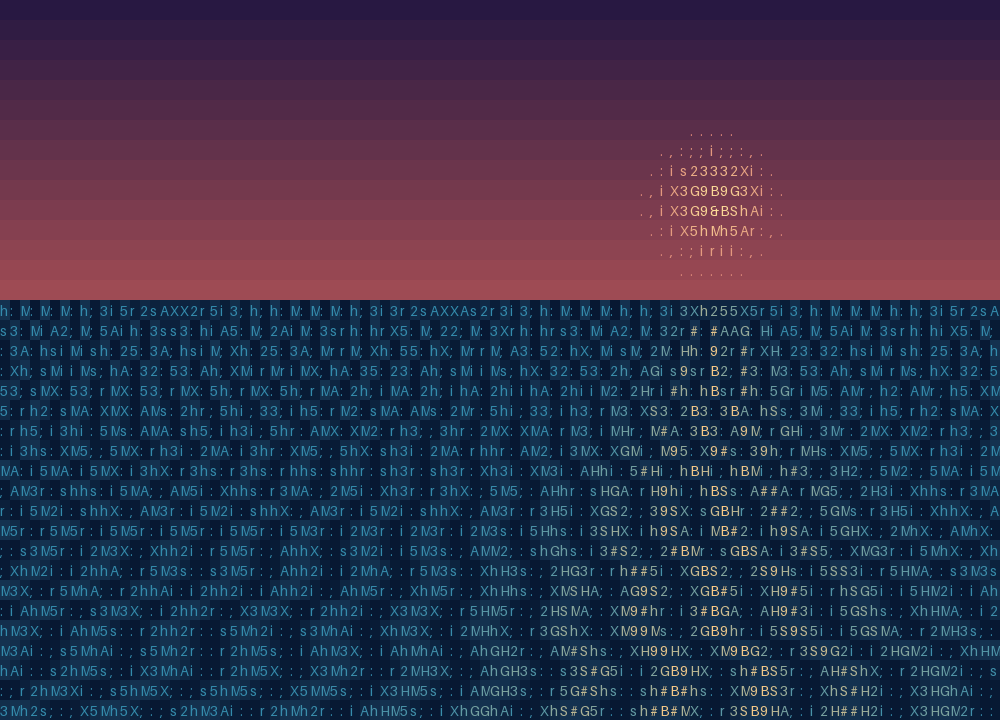

```sh
python -m examples.sunset_ocean
python -m examples.sunset_ocean --output output/sunset_ocean.html
```

[Source](../examples/sunset_ocean.py) · [Vector preview](images/sunset_ocean.svg)

## Mandelbrot study

**Procedural cells.** Escape-time iteration maps a slowly changing complex plane into colored glyphs.

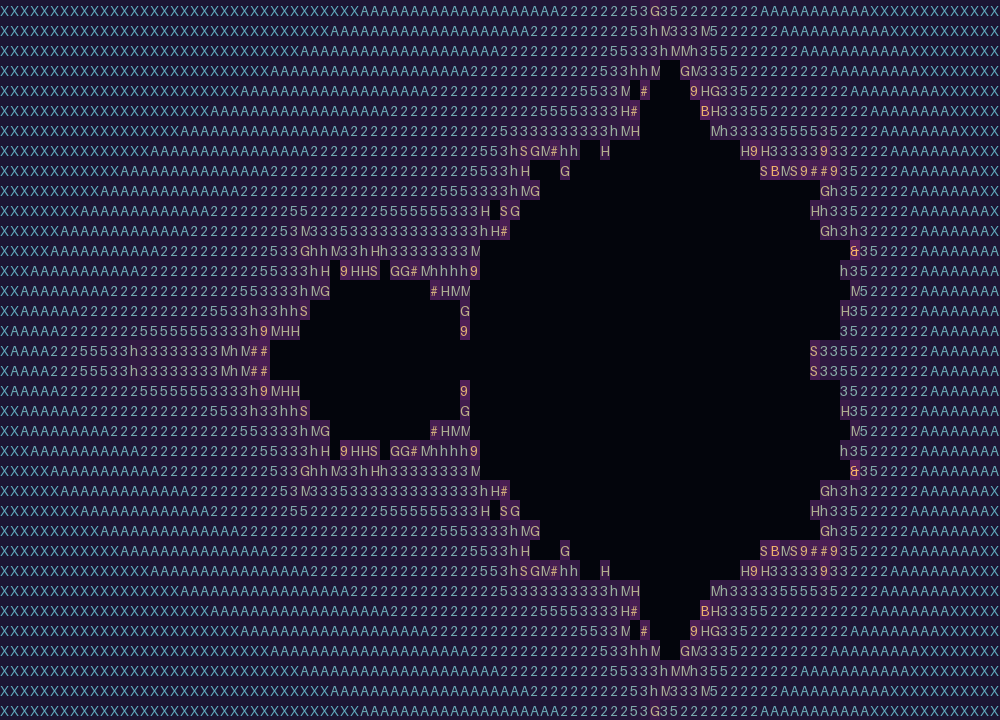

```sh
python -m examples.fractal_zoom
python -m examples.fractal_zoom --output output/fractal_zoom.html
```

[Source](../examples/fractal_zoom.py) · [Vector preview](images/fractal_zoom.svg)

## Phosphor radar

**Procedural cells.** A rotating sweep with persistence, range rings and fixed targets.

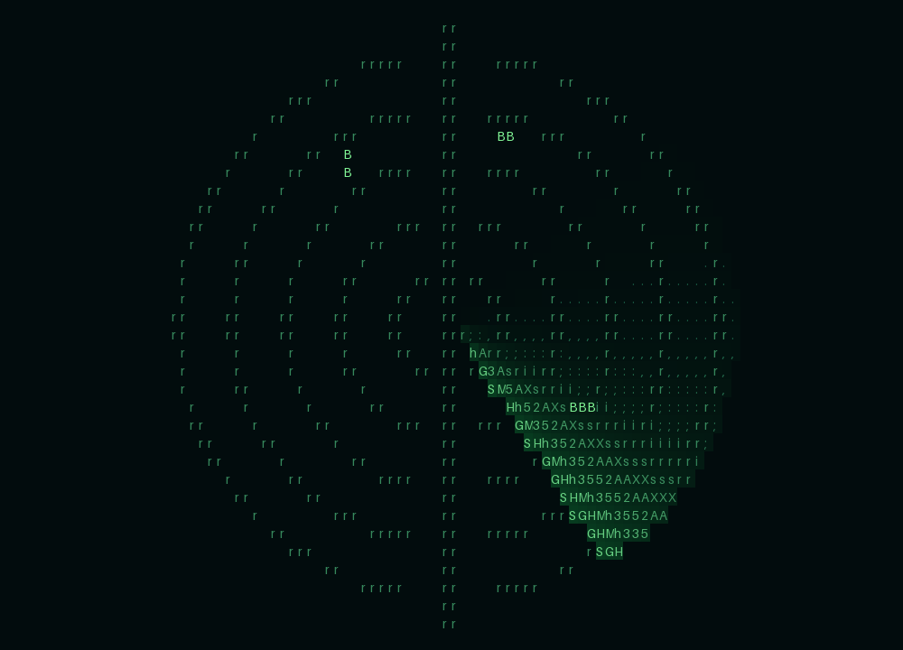

```sh
python -m examples.radar_station
python -m examples.radar_station --output output/radar_station.html
```

[Source](../examples/radar_station.py) · [Vector preview](images/radar_station.svg)

## Lava lamp

**Procedural cells.** Six moving inverse-distance fields merge into soft glowing blobs.

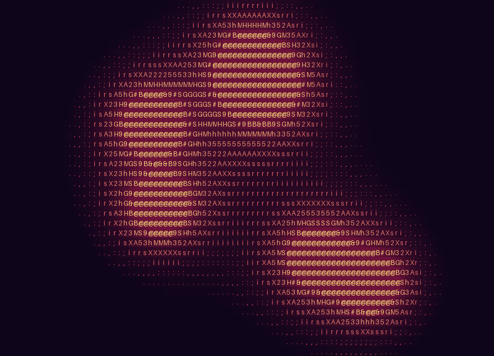

```sh
python -m examples.lava_lamp
python -m examples.lava_lamp --output output/lava_lamp.html
```

[Source](../examples/lava_lamp.py) · [Vector preview](images/lava_lamp.svg)

## Wave interference

**Procedural cells.** Two radial sources produce moving bands of constructive and destructive interference.


```sh
python -m examples.wave_interference
python -m examples.wave_interference --output output/wave_interference.html
```

[Source](../examples/wave_interference.py) · [Vector preview](images/wave_interference.svg)

## Starflight

**Projected particles.** Deterministic stars expand from a vanishing point with distance-based brightness.

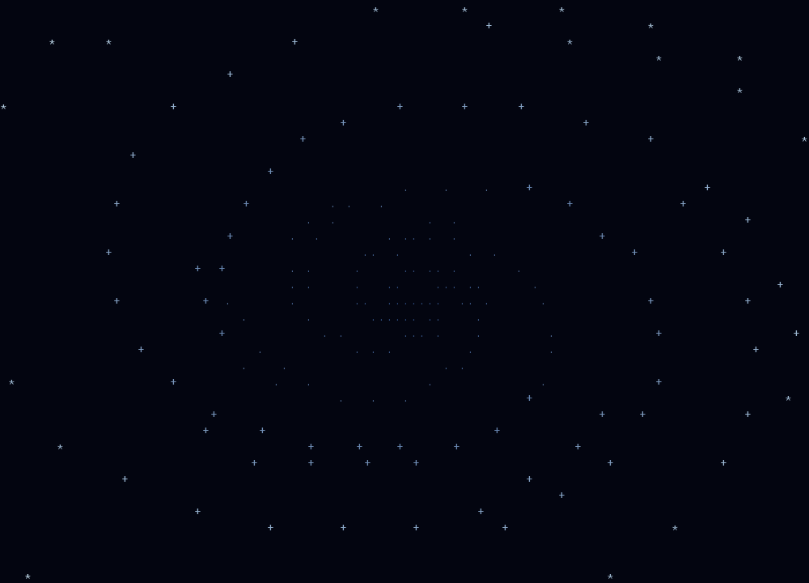

```sh
python -m examples.starflight
python -m examples.starflight --output output/starflight.html
```

[Source](../examples/starflight.py) · [Vector preview](images/starflight.svg)

## Twilight canal

**Grid ray caster.** A water corridor with illuminated facades, street lamps and a billboard boat.

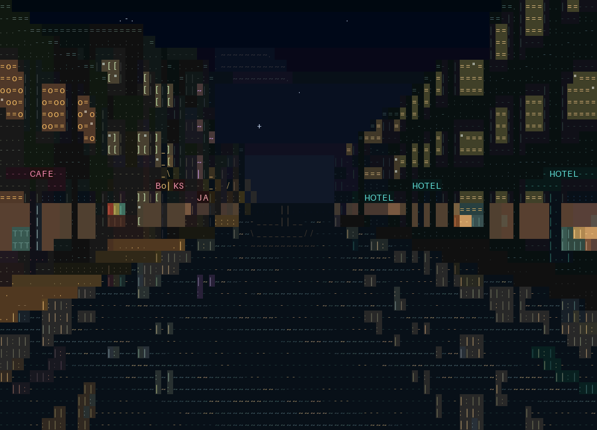

```sh
python -m examples.neon_canal
python -m examples.neon_canal --output output/neon_canal.html
```

[Source](../examples/neon_canal.py) · [Vector preview](images/neon_canal.svg)

## Fog monoliths

**Grid ray caster.** Two rows of progressively taller structures recede into mist at dawn.

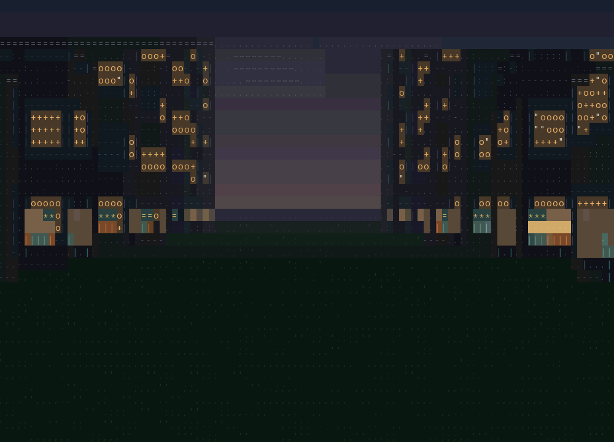

```sh
python -m examples.fog_monoliths
python -m examples.fog_monoliths --output output/fog_monoliths.html
```

[Source](../examples/fog_monoliths.py) · [Vector preview](images/fog_monoliths.svg)

## Torus sculpture

**Triangle mesh.** A parametric ring with a visible central opening and animated 3D transforms.

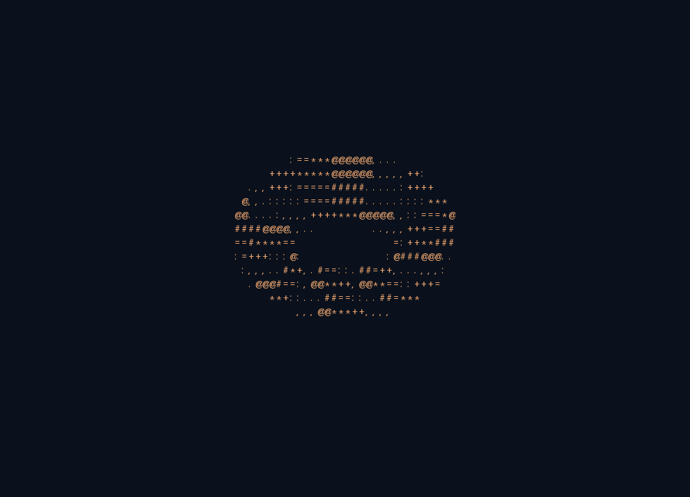

```sh
python -m examples.torus_sculpture
python -m examples.torus_sculpture --output output/torus_sculpture.html
```

[Source](../examples/torus_sculpture.py) · [Vector preview](images/torus_sculpture.svg)

## Ripple terrain

**Triangle mesh.** An animated height field rebuilt as triangles and viewed in perspective.

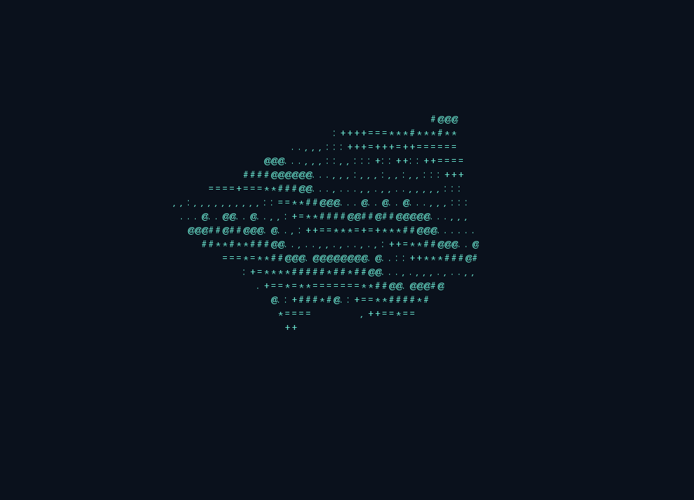

```sh
python -m examples.ripple_terrain
python -m examples.ripple_terrain --output output/ripple_terrain.html
```

[Source](../examples/ripple_terrain.py) · [Vector preview](images/ripple_terrain.svg)

## In motion

Four of the new demos also have reproducible animated previews. GIF uses a reduced palette; live truecolor output and SVG stills preserve more color detail.

### Wormhole

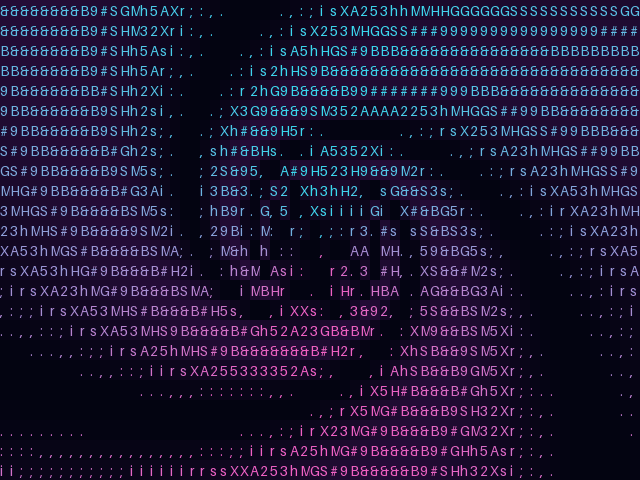

### Lava Lamp

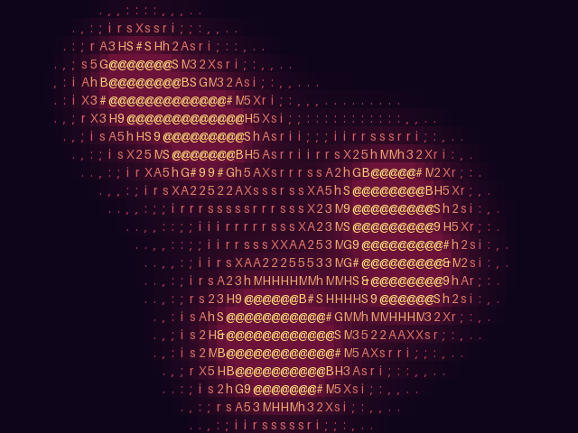

### Starflight

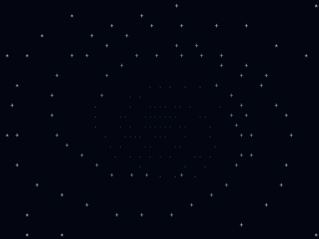

### Torus Sculpture

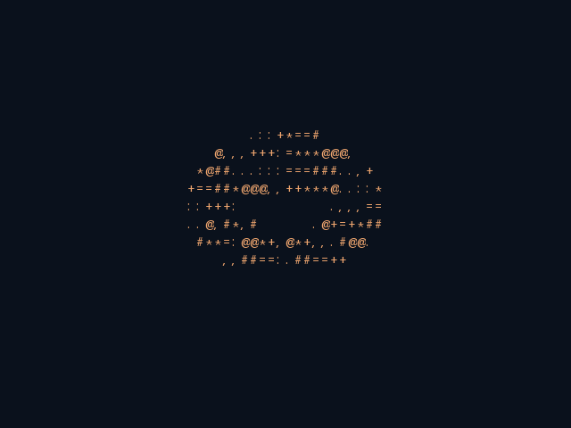

## Moving cameras around real 3D geometry

The following scenes keep every mesh fixed in world coordinates. Only the camera moves.

### Robot orbit

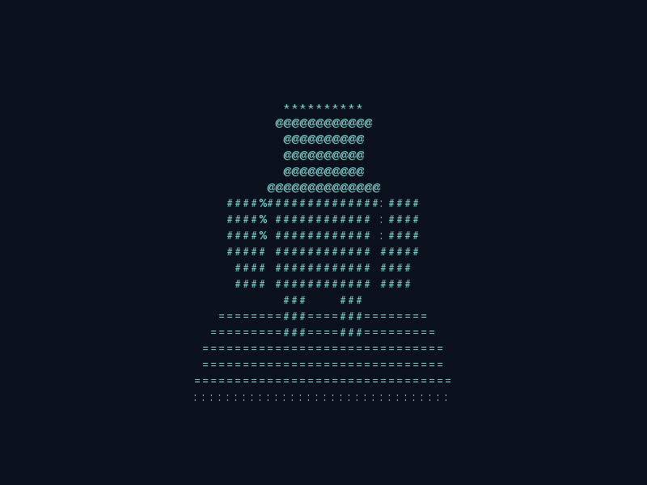

```sh
python -m examples.orbit_camera
```

[Source](../examples/orbit_camera.py) · [Still image](images/orbit_camera.png) · [Vector preview](images/orbit_camera.svg)

### Dolly through pillars

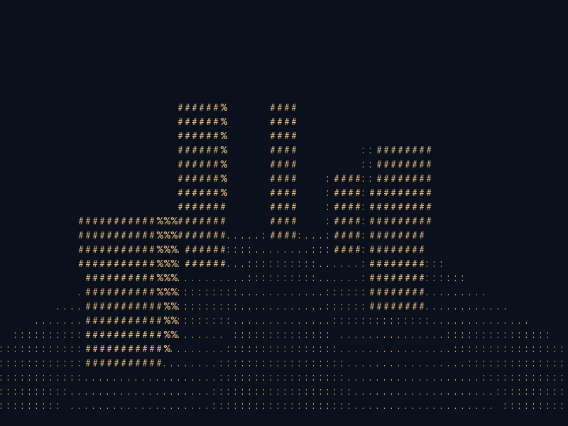

```sh
python -m examples.dolly_camera
```

[Source](../examples/dolly_camera.py) · [Still image](images/dolly_camera.png) · [Vector preview](images/dolly_camera.svg)

[Learn how the camera transforms work](cameras.md).

## Original examples

The original six demos remain available: [character waves](../examples/hello_terminal.py), [daylight street](../examples/raycast_street.py), [rainy night](../examples/night_rain.py), [sprite garden](../examples/sprite_garden.py), [rotating cube](../examples/rotating_cube.py), and [OBJ model](../examples/obj_model.py).

## Regeneration

```sh
python -m pip install Pillow
PYTHONPATH=src:. python tools/render_gallery.py
```

The tool generates 20 PNGs, 20 SVGs and seven GIFs from actual frames. The Glyph City showcase uses its upstream GIF directly and is not regenerated here.
